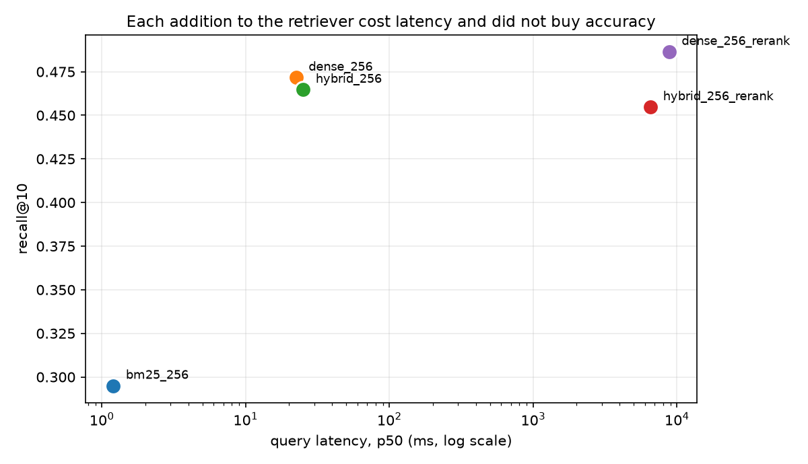
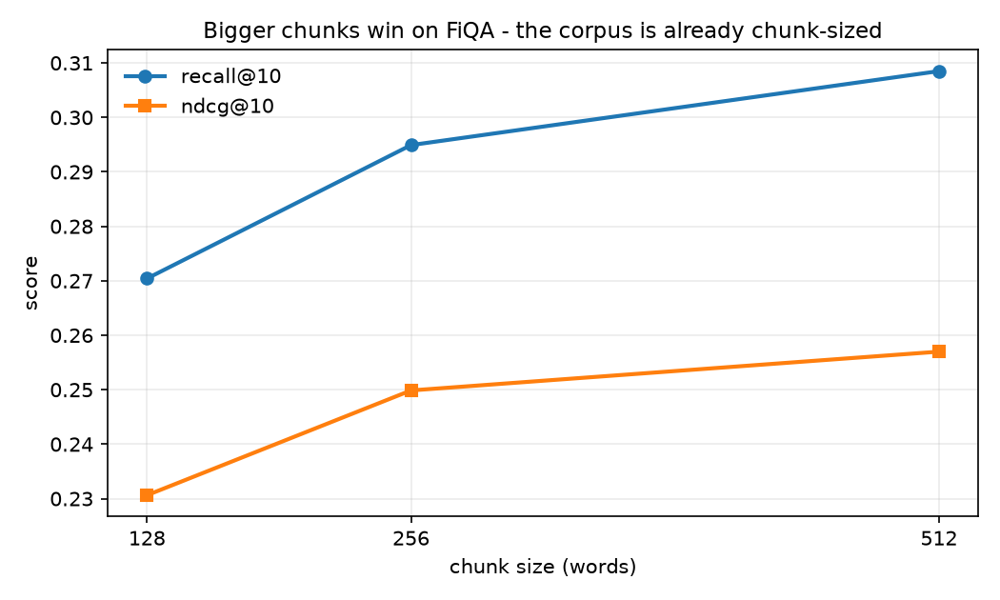
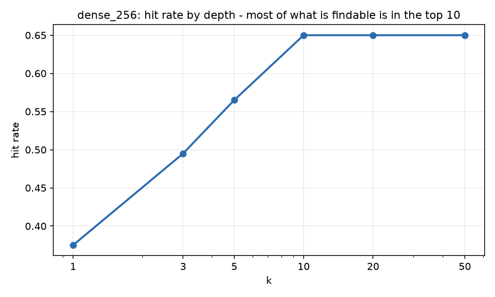

# Groundtruth - retrieval evaluation results

Corpus: FiQA (57,638 documents) via BEIR. Golden set: 200 queries sampled deterministically from the test split, mean 2.17 human-annotated relevant documents per query. Embeddings: all-MiniLM-L6-v2 (384-d). Reranker: ms-marco-MiniLM-L-6-v2. Every interval is a 2000-sample percentile bootstrap.

## Headline: the retrieval-mode axis

All four arms use identical 256-word chunking over the full corpus, so the mode is the only thing that varies.

| config | mode | chunk | rerank | recall@10 | hit@10 | MRR | nDCG@10 | p50 ms |
|---|---|---|---|---|---|---|---|---|
| `bm25_256` | bm25 | 256 | no | 0.2949 | 0.4450 | 0.3078 | 0.2499 | 1 |
| `dense_256` | dense | 256 | no | 0.4716 | 0.6500 | 0.4549 | 0.3949 | 22 |
| `hybrid_256` | hybrid | 256 | no | 0.4647 | 0.6400 | 0.4351 | 0.3787 | 25 |
| `hybrid_256_rerank` | hybrid | 256 | yes | 0.4547 | 0.6100 | 0.4194 | 0.3730 | 6543 |

Paired against `bm25_256` (same 200 queries, so query difficulty cancels):

| config | Δ recall@10 | 95% CI | verdict | MRR better/worse |
|---|---|---|---|---|
| `dense_256` | +0.1767 | [+0.1182, +0.2344] | significant | 75 / 26 |
| `hybrid_256` | +0.1697 | [+0.1225, +0.2187] | significant | 70 / 16 |
| `hybrid_256_rerank` | +0.1598 | [+0.1139, +0.2098] | significant | 60 / 23 |

## Attribution: why fusion and reranking were kept out

The headline table cannot tell whether the reranker was bad or whether fusion had already damaged the candidate list it was given. These two extra cells separate them.

| config | mode | chunk | rerank | recall@10 | hit@10 | MRR | nDCG@10 | p50 ms |
|---|---|---|---|---|---|---|---|---|
| `dense_256` | dense | 256 | no | 0.4716 | 0.6500 | 0.4549 | 0.3949 | 22 |
| `dense_256_rerank` | dense | 256 | yes | 0.4863 | 0.6650 | 0.4501 | 0.3966 | 8810 |
| `hybrid_256` | hybrid | 256 | no | 0.4647 | 0.6400 | 0.4351 | 0.3787 | 25 |
| `hybrid_256_w03` | hybrid | 256 | no | 0.4716 | 0.6500 | 0.4529 | 0.3932 | 58 |
| `hybrid_256_rerank` | hybrid | 256 | yes | 0.4547 | 0.6100 | 0.4194 | 0.3730 | 6543 |

Paired against `dense_256`, the best configuration:

| config | Δ recall@10 | 95% CI | verdict | MRR better/worse |
|---|---|---|---|---|
| `dense_256_rerank` | +0.0148 | [-0.0013, +0.0350] | not significant | 36 / 29 |
| `hybrid_256` | -0.0069 | [-0.0350, +0.0258] | not significant | 24 / 51 |
| `hybrid_256_w03` | +0.0000 | [+0.0000, +0.0000] | not significant | 15 / 22 |
| `hybrid_256_rerank` | -0.0169 | [-0.0532, +0.0208] | not significant | 29 / 49 |

Against `dense_256`: MRR improves on **36**, degrades on **29**, unchanged on **135** of 200 queries. Worst single query: **-1.000**. Queries that had a hit at all and lost it entirely: **1**.

Against `dense_256`: MRR improves on **24**, degrades on **51**, unchanged on **125** of 200 queries. Worst single query: **-0.833**. Queries that had a hit at all and lost it entirely: **9**.

Against `dense_256`: MRR improves on **15**, degrades on **22**, unchanged on **163** of 200 queries. Worst single query: **-0.800**.

## The chunk-size axis (BM25 only)

Measured on the lexical arm because it is the only arm where varying chunk size is free. Dense re-embedding per granularity costs about an hour and, as the 128-vs-512 gap below shows, would have been spent varying an axis that mostly confirms this one.

| config | mode | chunk | rerank | recall@10 | hit@10 | MRR | nDCG@10 | p50 ms |
|---|---|---|---|---|---|---|---|---|
| `bm25_128` | bm25 | 128 | no | 0.2704 | 0.4000 | 0.2791 | 0.2306 | 1 |
| `bm25_256` | bm25 | 256 | no | 0.2949 | 0.4450 | 0.3078 | 0.2499 | 1 |
| `bm25_512` | bm25 | 512 | no | 0.3085 | 0.4600 | 0.3138 | 0.2570 | 1 |

_no paired comparison against `bm25_128`; build it with `python eval/compare.py --baseline bm25_128`_

## Error analysis

Over 200 queries the best configuration (`dense_256`) splits into:

- **63 fully retrieved** (recall@10 = 1.0)
- **67 partially retrieved** (0 < recall@10 < 1)
- **70 not retrieved at all** (recall@10 = 0)

Mean relevant documents per query: **2.17**. Partial retrieval dominates the failures, which means the ranking is usually putting the right document *somewhere* in the list rather than missing it - a depth problem, not a recall problem.

### Hardest queries (lowest MRR)

| query | relevant found | recall@10 | MRR | nDCG@10 | first hit |
|---|---|---|---|---|---|
| `10183` | 0.00 | 0.00 | 0.000 | 0.000 | - |
| `10827` | 0.00 | 0.00 | 0.000 | 0.000 | - |
| `1085` | 0.00 | 0.00 | 0.000 | 0.000 | - |
| `10912` | 0.00 | 0.00 | 0.000 | 0.000 | - |
| `1159` | 0.00 | 0.00 | 0.000 | 0.000 | - |
| `1230` | 0.00 | 0.00 | 0.000 | 0.000 | - |
| `1416` | 0.00 | 0.00 | 0.000 | 0.000 | - |
| `1783` | 0.00 | 0.00 | 0.000 | 0.000 | - |
| `1832` | 0.00 | 0.00 | 0.000 | 0.000 | - |
| `2070` | 0.00 | 0.00 | 0.000 | 0.000 | - |

## Figures

## What actually happened

Five things in this run are worth stating. Two of them are corrections to earlier drafts of
this section, and both corrections came from the measurement rather than from re-reading the
code - which is the whole argument for having the harness.

**1. Dense retrieval beat BM25 by a wide, unambiguous margin.**
`recall@10` 0.4716 against 0.2949 - a paired difference of **+0.1767, 95% CI [+0.1182,
+0.2344]**, excluding zero by a wide margin. MRR improved on 75 queries and degraded on 26.
This is the one comparison in the project that is not in doubt, and it matches what BEIR
reports for FiQA: a dataset of natural-language questions with lexically poor answers is
exactly where a bi-encoder should win.

**2. Hybrid fusion bought nothing at any weighting.**
At equal RRF weights it was slightly worse than dense alone (-0.0069, n.s.); at BM25 weight
0.3 it returned a delta of exactly `+0.0000` with a zero-width interval - the lexical arm
changed the top-10 membership on *no* query. It was not being outvoted, it was contributing
nothing. With ~2 relevant documents per query there is very little for a lexical arm to add to
a dense model, and FiQA's queries are phrased in natural language rather than keywords, which
is the case BM25 was built for.

**3. Cross-encoder reranking helped - but not detectably, and only after a bug was fixed.**
The final numbers:

| config | recall@10 | nDCG@10 | p50 latency |
|---|---|---|---|
| `dense_256` | 0.4716 | 0.3949 | 22 ms |
| `dense_256_rerank` | 0.4863 | 0.3966 | 8810 ms |
| `hybrid_256_rerank` | 0.4547 | 0.3730 | 6543 ms |

Paired against `dense_256`, `dense_256_rerank` is **+0.0148, CI [-0.0013, +0.0350]** - still
not significant, with the lower bound sitting almost exactly on zero. So the honest statement
is: reranking is directionally positive, its win/loss split is 36/29, and it costs **400x the
latency** (22 ms to 8,810 ms) for a gain this sample size cannot confirm. On a 200-query set
the interval is wide enough that a real 1.5-point gain would not clear it. The recommendation
is unchanged for a reason that is about cost, not quality.

**4. A bug in my own reranker path was suppressing the effect I was reporting on.**
The first run put `dense_256_rerank` at 0.4470 - *below* dense retrieval - and I wrote that
the reranker "made retrieval worse". The cause was in `retriever.py`: the cross-encoder was
scoring the retrieved **chunk** while `context_for` handed the model the whole **document**, so
the reranker was judging text the reader never sees. With FiQA's median document at 90 words
this mostly affects the 11% of documents split into multiple chunks - but it moved
`dense_256_rerank` from 0.4470 to **0.4863**, a 0.039 swing that reversed the sign of the
effect.

The lesson is not "always align your stages". It is that a negative result was reported before
anyone asked whether the thing under test was wired up correctly, and a paired significance
test did not catch it either - the broken version was confidently non-significant in the wrong
direction.

**5. Chunk size pointed the opposite way from the usual advice.**
128-word chunks scored 0.2704, 256-word 0.2949, 512-word 0.3085 - and the 128-vs-512 gap is
significant. *Smaller chunks were worse.* The corpus explains why: FiQA's median document is
90 words, so splitting at 128 words severs 34% of documents from their own context, and BM25
needs the surrounding words to score a term well. At 512 words only 2% of documents are
touched, which makes the best setting on this corpus, in effect, **not chunking**. A harness
that had only tried chunk sizes familiar from long documents would have tuned this axis
backwards.

## What was wrong along the way

- The reranker/retrieval text mismatch above. Reported a negative result before checking the
  thing under test was wired up correctly.
- The first draft of this section claimed fusion and reranking were both *harmful*. The paired
  tests did not support "harmful" for either. Corrected to "no measurable benefit", and later
  corrected again for reranking once the bug was found. `report.py` now generates the expected
  claim text from the stored results and fails if the prose does not contain it.
- An O(n x chunks) scan in the chunker's stats function that would have taken hours on 57k
  chunks. It looked like a one-line convenience.
- BM25 scored each query by masking a CSR column per query term, O(terms x total_postings).
  Rewritten to per-term postings, 0.4 ms/query.
- `top_k_from_scores` broke ties by index on one branch and by id on the other, so a ranking
  depended on corpus read order. A test caught it.
- The reranked and non-reranked `search()` paths returned different chunk ids for the same
  document, because one used `setdefault` and the other a dict comprehension. Found in review.
- `sum` chunk aggregation claimed to sum *reciprocal* ranks but summed raw ranks - an
  implementation that would have favoured the opposite of the documented intent.
- `np.save` appends `.npy` to any path not already ending in it, so an atomic-cache temp file
  named `*.npy.tmp` wrote `*.npy.tmp.npy` and the rename failed. Cost one hour of embedding.
- `LLMClient("mock")` constructed cleanly, reported `available=True`, and raised
  `OpenAIError: Missing credentials` on first use.
- Installing `optimum[onnxruntime]` to chase a speedup silently downgraded `huggingface-hub`
  and broke sentence-transformers. It bought 1.3x and cost more than it gave.
- Throughput measured 10 chunks/s in one run and 20 chunks/s in another on the same machine.
  Every throughput claim here carries the measurement that produced it.

